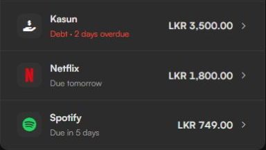
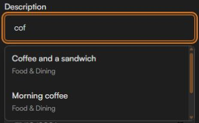
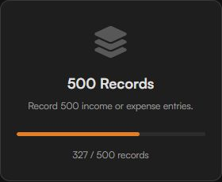

Kaasi v6 brought budgets, credit card tools and a whole lot more to the dashboard. With **Kaasi v7**, I wanted to make those tools easier to use every day: spend less time repeating entries, keep track of upcoming subscription payments, and access your records across devices.

There's plenty more under the surface too. Here's a look at what's new and improved.

## ☁️ Automatic Cloud Sync

Your records can now follow you between devices without manually uploading a backup after every change.

* **Automatic sync:** Sign in with Google and choose cloud sync to keep your saved records up to date when you're online. Changes are still saved locally first, so you can continue tracking offline.
* **A clearer view of sync:** Dashboard indicators and the Data & Backups section show the current status, including when you're offline or a sync needs attention. You can also run a sync check manually.
* **Review before replacing:** When local and cloud copies have both changed, Kaasi lets you compare them and choose which copy to keep. Records aren't automatically merged; replacing a copy removes changes that exist only in that copy.
* **Pause when you need to:** Pause automatic sync on a device and use the explicit upload or restore options when you want to manage copies yourself. Importing a local backup pauses automatic sync so you can review what happens next.
* **A safer start on another device:** Sign in during setup to restore an existing cloud copy. Cloud transfers use validation and checks to help prevent newer changes from being overwritten unexpectedly.

## 🔁 Subscriptions & Upcoming Payments

From streaming services to recurring bills, Kaasi can now help you keep track of what's coming up.

<figure class="article-visual article-visual-side article-visual-upcoming">
  
  <figcaption>Upcoming payments at a glance. Sample data shown.</figcaption>
</figure>

* **Subscription schedules:** Add your services, amounts, renewal dates and payment details in one place. Choose from the built-in service catalogue or use your own names and icons.
* **Upcoming payments:** See approaching renewals on the dashboard, including overdue items, so they're easier to spot alongside the rest of your finances.
* **Record payments your way:** Confirm a renewal when it happens and choose how to record it. You remain in control of what gets recorded; a scheduled renewal doesn't silently add a transaction.
* **Pause and adjust:** Pause a subscription, correct dates, manage its schedule or remove it when you no longer need it.

## ✨ Kaasi Gets More Helpful as You Use It

The more records you add, the more useful your own history can become when you're entering something similar again.

<figure class="article-visual article-visual-side">
  
  <figcaption>Suggestions from your own transaction history.</figcaption>
</figure>

* **Description suggestions:** Start typing a transaction or credit card description to see matching entries from your history. Select one to reuse the description and, when appropriate, its category.
* **Names you've used before:** Debts and receivables can suggest matching names from your previous records too.
* **You're still in charge:** Suggestions come from your existing local records, without using AI, and are only applied when you select one. Amounts and other financial details aren't filled in for you.

## 🗃️ A Stronger Foundation for Your Data

Kaasi previously used **localStorage**, which typically allows around 5 MB of data. Even that could last an estimated six to seven years of use, depending on how much you record. Kaasi v7 moves financial records and app preferences to **IndexedDB**, a database built into your browser that gives your history more room to grow while keeping your data on your device.

* **A guided upgrade:** Existing users are taken through a one-time storage upgrade. Kaasi checks the data before switching to the new storage and retains the original local copy for recovery.
* **Backups still work:** Export your records to a JSON file, import compatible backups or use optional cloud sync. The new storage does not replace your backups.
* **Better recovery:** If saved data can't be read or a storage operation fails, Kaasi provides recovery options rather than silently starting with an empty dashboard.
* **Storage protection:** Kaasi can ask your browser to protect its locally saved data from automatic cleanup. You can check its status in Settings; browser support varies, so keep a separate backup too.

## ⚙️ A Redesigned Settings Experience

Settings has been reorganised to make the growing list of controls easier to navigate, whether you're on a computer or a phone.

* **A clearer workspace:** Find related controls together, with responsive navigation and more room for the section you're working in.
* **Accounts, categories and budgets:** Manage your financial setup with clearer forms and guidance, including the effects of category changes and exclusions.
* **Data & Backups:** Find storage, local backups and cloud sync controls in one place, with clearer status and actions.
* **Subscriptions and information:** Manage recurring services from Settings, and find the tutorial, support details and Extras in their own sections.

## 👋 Getting Started & Guided Tour

New to Kaasi? The first-run experience has been refreshed to help you set up your accounts and understand the dashboard without having to discover everything at once.

* **A more guided setup:** Choose your starting details or bring an existing backup into Kaasi.
* **A tour of the tools:** Learn where the main features live and revisit the tutorial from Settings whenever you need it.
* **Calculator practice:** Try an example calculation during the tour. Practice entries aren't saved to your financial records.

## 💳 Credit Cards & Payments

Credit card payments are more flexible in v7, especially when you're settling more than one purchase at a time.

* **Individual and selected payments:** Pay a purchase directly or select multiple purchases for a payment, with clearer summaries and more focused controls.
* **Partial payments across purchases:** Apply partial payments to selected purchases and keep track of what's still owed.
* **Optional expense logging:** Choose whether a credit card payment should also be recorded as an expense, including when paying multiple purchases.
* **Categories on purchases:** Choose a category for a credit card purchase when useful, and use category defaults in payment workflows.

## 🏆 Milestones, Extras & the Cash Counter

<figure class="article-visual article-visual-side">
  
  <figcaption>See your progress towards the next milestone.</figcaption>
</figure>

* **Milestones:** See achievements for starting out, recording regularly, reaching transaction counts and spending more time with Kaasi. Progress and earned dates are available in Extras.
* **A home for Extras:** Find milestones and other supporting tools in Settings without crowding the main dashboard.
* **Cash counter improvements:** The cash counter has been redesigned and made easier to use, with clearer amounts and an option to access it from Extras.

## 💰 Transfers & Everyday Controls

* **Transfer improvements:** Account choices and defaults are clearer when moving money between accounts.
* **Quicker access:** Updated shortcuts and controls make it easier to get to transaction history, debts, receivables and other frequently used tools.

## 🎨 Design & UI/UX Polish

* **Mobile layouts:** Refined transaction history, subscription management, payment controls, summaries and dialogs for smaller screens.
* **Charts that fit:** The income and expense chart adjusts its displayed window for smaller screens, and chart updates are smoother.
* **Clearer balances:** Credit card summaries and large financial values have been adjusted to remain easier to read across screen sizes.
* **Better keyboard support:** More controls can be reached and operated by keyboard.
* **More comfortable motion:** Reduced-motion preferences are respected across more of the app.
* **Cleaner forms:** Improved field order, calculator controls, checkboxes, payment forms and action labels make common tasks easier to follow.
* **Less interruption:** Update notices wait for a more appropriate moment when you're working in a form, dialog or protected screen.

## 🔧 Under the Hood

* **Safer saves:** If your browser can't save a change, Kaasi tells you, keeps your entry in the form so you can retry, and keeps your previously saved records intact.
* **Backup checks:** Imported and restored backups are validated before replacing records, with recovery safeguards if something goes wrong.
* **Protection against stale changes:** Additional checks help prevent older tabs, overlapping saves or an out-of-date cloud copy from silently replacing newer data.
* **More accurate backup status:** Changes made while a backup is uploading remain marked as needing another sync rather than being reported as already backed up.
* **Receivable validation:** An unsuccessful edit no longer leaves a rejected amount in memory where it could affect a later retry.
* **Fresh transaction history:** The All Transactions view updates after records are edited while retaining the active search, filters and expanded groups.
* **More reliable entry:** Invalid amounts and incomplete calculator expressions are rejected.
* **Dates stay put:** A date you've selected for an unfinished entry is retained when returning to the app.
* **Category changes:** Renaming an excluded category keeps its exclusion settings and updates the related references.
* **PIN lock improvements:** Background shortcuts and data actions are blocked while the app is locked.
* **Updates and offline assets:** Improvements to app updates and the files stored for offline use help keep the experience consistent between launches.
* **Update available notice:** When a new version is ready, a visible notice lets you update the app. It waits until you're not in the middle of an entry or another task.

Kaasi is free to use, and I hope v7 makes it a little easier to stay on top of your money. If you'd like to support its development, you can find the donation details on the home page.
